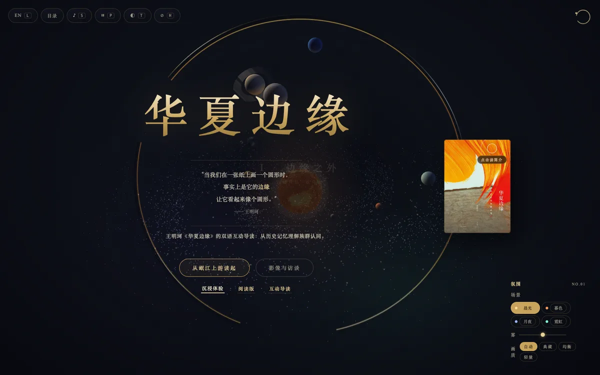
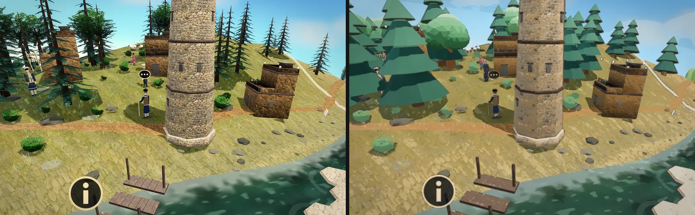

# 华夏边缘 · Huaxia Frontiers

[](https://github.com/tanyaqiongcode/huaxia-frontiers-3d/actions/workflows/qa.yml)
[](https://tanyaqiongcode.github.io/huaxia-frontiers-3d/)
[](LICENSE)

为王明珂《华夏边缘：历史记忆与族群认同》而建的一座 3D 主题站。

*A bilingual (Chinese / English) web companion to Wang Ming-ke's* Huaxia Frontiers: Historical Memories and Ethnic Identities. *It has three parts: an immersive 3D site, a reading edition, and* Walking the Edge, *a small 3D walk through five fictional field sites where the reader collects sources, hears five short stories and earns reading cards. Scenes and speakers are fictional; the book is the authority on its arguments.*



> "当我们在一张纸上画一个圆形时，事实上是它的'边缘'让它看起来像个圆形。"

一本书讲的是边界如何被画出、被记住、被遗忘；这座站想做的，是让读者站到那条线上，看它在脚下移动。

**在线访问**：https://tanyaqiongcode.github.io/huaxia-frontiers-3d/

## 三种进入方式 · Three ways in

- **沉浸版 · Immersive edition**——青铜之环、发光的内核与漂浮的记忆碎片，在动态的星野里读完全书的骨架：https://tanyaqiongcode.github.io/huaxia-frontiers-3d/
- **阅读版 · Reading edition**——同样的内容，换成适合安静阅读的版式：标出当前所在章节，可以回到上次读到的位置，导图显示完整标题，全程可用键盘操作；动态背景可以暂停，也会跟随系统的"减少动态效果"设置：https://tanyaqiongcode.github.io/huaxia-frontiers-3d/reading/
- **边缘行走 · Interactive reading guide**——走过岷江河谷、河湟遗址、长城、国道边的羌寨与北川，听五段讲述，拾起十七件史料，每一处换得一张读书卡。场景与讲述者均为虚构，书中观点以原著为准：https://tanyaqiongcode.github.io/huaxia-frontiers-3d/game/

## 站里有什么

| 区块 | 内容 |
|---|---|
| 首屏 | 一枚青铜边缘环，环抱发光的内核，记忆碎片在四周缓缓流转；粒子疏密、雾气与晨昏光色都可以随手调节 |
| 概念八章 | 从"什么是中国人"一路走到"边缘研究法"，以自然志卡片的样子排开 |
| 图录 | 四张主题图 |
| 3D 造物记 | 一段从空白场景开始、一块一块搭起来的延时影像，附渲染图与可下载的 Blender 文件 |
| 推荐语 · 作者与版本 · 影像 · 首译 | 梁文道、罗新、刘苏里、岱峻的推荐；1997 到 2020 年的版本流变；精选讲座与解读（播放量为 2026 年 11 月初的记录，不会自动更新）；首译项目正在进行，这部书正走向汉语之外的读者 |

## 两种画风 · Two art styles

互动导读可以在"写实"与"淡彩插图"之间切换。下图是羌寨同一机位、晴天正午的对比（左写实，右淡彩）；五个场景的完整对比见 [docs/compare-five.webp](docs/compare-five.webp)。



## 怎么看

- 顶部命令条：声音 `S` · 暂停 `P` · 绢本浅色 `T` · 隐去界面 `H`
- 右下氛围面板：粒子疏密、雾气、晨昏光色
- 两种底色：深色青铜，浅色绢本

## 仓库里有什么

```
├── src/site.src.html        # 沉浸版与阅读版的共用源码（改这里，再生成下面两页）
├── index.html               # 沉浸版（由 src 生成）
├── reading/index.html       # 阅读版（由 src 生成）
├── game/index.html          # 边缘行走 · 互动导读
├── assets/three.min.js      # three.js r128（本地化）
├── assets/models/*.glb      # 导读里的碉楼、石屋、长城、烽燧、遗址、树与牲畜（由 blender/game_models.py 生成）
├── assets/tex/              # 写实材质
├── assets/build.mp4 · render_01..03.webp · plates/  # 造物记与图录
├── docs/                    # README 用的截图与画风对比图
├── tools/qa_run.mjs         # 无头浏览器回归测试与画风对比截图
├── tools/site_src.py        # 由共用源码生成两页 / 检查是否一致
├── tools/build_single_html.py  # 打包互动导读的单文件分享版
├── .github/workflows/qa.yml # 推送与 Pull Request 时自动跑上面的检查
├── LICENSE · NOTICE.md      # 代码许可（MIT）与内容、第三方素材说明
└── blender/build_complete.blend
```

## 改动与测试

沉浸版和阅读版共用 `src/site.src.html`：两页共用的内容只写一次，只属于某一页的段落用独占一行的 `@@imm`（沉浸版）、`@@read`（阅读版）与 `@@end` 包起来，资源路径写作 `{{R}}assets/…`。

```bash
python3 tools/site_src.py build          # 由源码生成 index.html 与 reading/index.html
python3 tools/site_src.py check          # 检查两页与源码一致
node tools/qa_run.mjs                    # 回归：五场景 × 五天气 × 两画风、两站中英文、拍照与存档（约 2 分钟）
node tools/qa_run.mjs --only-shots --shots <目录>   # 五场景写实 / 淡彩同机位对比图
sh tools/install-hooks.sh                # 安装提交前检查（上面两项检查在每次提交前自动运行）
```

回归测试需要本机的 Google Chrome、python3 和 Node 22 以上，不需要安装 npm 包。

本地预览：在仓库根目录运行 `python3 -m http.server 8000`，再打开 http://localhost:8000/ 。

**已测试的浏览器**：桌面版 Chrome（自动回归在 GitHub Actions 的 Ubuntu 上运行，提交前也在本机 macOS 上运行）。Safari、Firefox 与手机浏览器尚未系统测试。

**反馈**：发现错误或有建议，欢迎在 [Issues](https://github.com/tanyaqiongcode/huaxia-frontiers-3d/issues) 留言。

## 重新搭一遍

首页的 3D 场景：用 Blender 直接打开 `blender/build_complete.blend`。

导读里的模型（碉楼、石屋、长城、烽燧、河湟遗址、尔玛人家、树、牲畜）：

```bash
blender --background --factory-startup --python blender/game_models.py
```

## 版权

代码采用 [MIT 许可证](LICENSE)；原书文字与插图、重绘地图和第三方素材不在此列，详见 [NOTICE.md](NOTICE.md)。

本站用于图书介绍与学术推广。推荐语的版权归原作者；Blender 文件、渲染图、延时影像与主题图为本项目原创。

首页时间轴里的四幅地图（`assets/book/svg/fig-104.svg`、`transparent/fig-099.svg`、`fig-113.svg`、`fig-127.svg`）依据原书（2020 年中文版）插图重绘，并非本项目原创；版权归原书作者与出版方，仅用于图书介绍。

## 致谢 · Credits

- three.js r128（MIT）；行星贴图来自 [Solar System Scope](https://www.solarsystemscope.com/textures/)（CC BY 4.0）与 NASA；月面贴图来自 NASA（经 three.js examples）
- 互动导读里的碉楼、羌寨平顶石屋、汉代夯土长城与烽燧（夯层夹芦苇，依河西汉塞形制）、河湟齐家文化半地穴房址与彩陶罐、冷杉／白杨／核桃、绵羊／黄牛／马、北川"尔玛人家"碉房（石屋连小碉，供白石，挂羌红）：均以 Blender 脚本建模（`blender/game_models.py`，本项目原创），导出为 `assets/models/*.glb`，由 three.js GLTFLoader（r128，MIT）载入
- 写实材质来自 [Poly Haven](https://polyhaven.com)（CC0）：aerial_grass_rock（地面）、stone_wall（碉楼石墙）、brown_mud_dry（夯土、黄土）、weathered_planks（木作）、white_plaster_02（北川白墙）、asphalt_02（国道）、pine_bark（树皮），1K 颜色、法线、粗糙度贴图，存于 `assets/tex/`
- 模型的环境光遮蔽由 Blender Cycles 烘焙进顶点色；树冠为叶片卡，叶片与针叶贴图由程序绘制
- 人物与装束：Blender 脚本建模（`blender/npc_figure.py`，本项目原创，共 19 个骨骼人物（动作由游戏代码逐帧驱动，GLB 不含内嵌动画）），服饰参照岷江上游羌族与河湟民族志通例（包头帕、长衫、羊皮褂、绑腿、云云鞋）；人物均为虚构
- 动物与地景模型：`blender/animals.py` 与 `blender/game_models.py`（本项目原创）
- 重新生成模型：`blender --background --factory-startup --python blender/npc_figure.py -- all`（变体见脚本内 VARS）
- 单文件分享版由 `tools/build_single_html.py` 打包（内联 three.js、GLTFLoader、全部模型与贴图）；可在 [Releases](https://github.com/tanyaqiongcode/huaxia-frontiers-3d/releases) 下载，下载后直接用浏览器打开，不需要网络
- 信息图：编辑组 · Infographics: the editorial team
- 时间轴地图：据原书（2020 年中文版）插图重绘，© 原作者与出版方 · Timeline maps redrawn from figures in the original book (2020 Chinese edition), © the author and publisher
